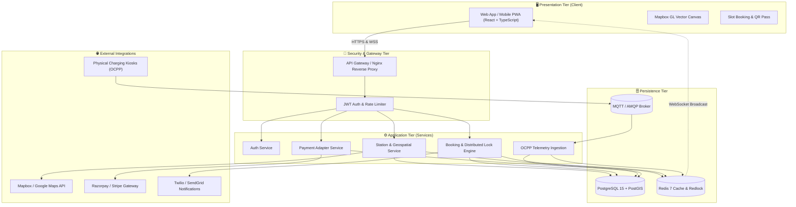

# ⚡ EV Charging Station Locator (SmartCharge)

> A cloud-native, responsive web platform enabling electric vehicle drivers to discover nearby charging stations in real time, filter by connector type and charging speed, reserve slots with guaranteed holds, navigate seamlessly, and complete secure payments.

---

## 📌 Academic Course & Assessment Information

* **Course Title:** Software Engineering and Design Principles
* **Course Code:** CS311L

---

## 📑 Lab Assessment Deliverables Matrix (Sessions 1 – 9)

All lab sessions mandated in the assessment curriculum are documented with formal deliverables in the [`docs/`](docs/) directory:

| Session | Topic & Coverage | Deliverable Document | Industry Mapping | Status |
| :---: | :--- | :--- | :--- | :---: |
| **Session 1** | **Introduction to Software Engineering Tools**<br/>• Git & GitHub Version Control Basics<br/>• Repository Creation & Branching Workflows<br/>• Software Project Lifecycle (Agile Scrum)<br/>• Team Formation & Project Domain Selection | 📄 [`docs/exp1.md`](docs/exp1.md)<br/>*GitHub Repository Setup & Version Control Report* | Collaborative Development | ✅ Completed |
| **Session 2** | **Problem Identification & Feasibility Analysis**<br/>• Identification of Real-World Problems<br/>• Problem Statement Writing<br/>• Technical & Operational Feasibility Analysis<br/>• Project Scope Definition | 📄 [`docs/exp2.md`](docs/exp2.md)<br/>*Problem Statement & Feasibility Document* | Product Requirement Analysis | ✅ Completed |
| **Session 3** | **Requirements Engineering – Elicitation**<br/>• Stakeholder Identification & Categorization<br/>• Interview Simulation & Questionnaires<br/>• User Persona Creation (Driver, Fleet, Operator)<br/>• Agile User Story Writing & INVEST Criteria | 📄 [`docs/exp3.md`](docs/exp3.md)<br/>*Requirement Gathering Report* | Business Analysis & Client Interaction | ✅ Completed |
| **Session 4** | **SRS Documentation**<br/>• Complete IEEE Std 830-1998 / ISO/IEC/IEEE 29148 Format<br/>• Functional Requirements [FR-1 to FR-10]<br/>• Non-Functional Requirements (Performance, Security, Reliability)<br/>• External Interfaces (UI, Hardware, Software, Comm) | 📄 [`docs/exp4.md`](docs/exp4.md)<br/>*Complete SRS Document* | Formal Documentation Standards | ✅ Completed |
| **Session 5** | **UML Use Case Modeling**<br/>• Primary & Supporting Actor Identification<br/>• UML Use Case Diagram with `<<include>>` & `<<extend>>`<br/>• Standardized Use Case Description Templates & Narratives | 📄 [`docs/exp5.md`](docs/exp5.md)<br/>*Use Case Diagram & Operational Narratives* | Requirement Modeling | ✅ Completed |
| **Session 6** | **UML Class Diagram Design**<br/>• Object-Oriented Analysis (OOA)<br/>• Class Identification, Attributes, Methods & Visibility<br/>• Inheritance, Composition, Aggregation & Multiplicities<br/>• Complete UML Class Diagram & Data Dictionary | 📄 [`docs/exp6.md`](docs/exp6.md)<br/>*UML Class Diagram & Structural Specifications* | Object-Oriented System Design | ✅ Completed |
| **Session 7** | **UML Sequence & Activity Diagram Modeling**<br/>• Sequence Diagrams: Search, Booking & Hardware Telemetry<br/>• Lifelines, Message Flows & Distributed Redlock<br/>• Activity Diagrams: End-to-End User Booking Workflow & Maintenance | 📄 [`docs/exp7.md`](docs/exp7.md)<br/>*Sequence & Activity Diagrams Report* | Interaction & Workflow Modeling | ✅ Completed |
| **Session 8** | **Software Design Principles**<br/>• Principles of Modularization (Parnas Criteria)<br/>• Qualitative Coupling & Cohesion Analysis Matrix<br/>• Function-Oriented (SA/SD) vs Object-Oriented Design (OOAD)<br/>• Top-Down vs Bottom-Up Design Synthesis | 📄 [`docs/exp8.md`](docs/exp8.md)<br/>*Software Design Principles Analysis Report* | Software Design Engineering | ✅ Completed |
| **Session 9** | **Software Architecture Design & Design Patterns**<br/>• Multi-Tier Layered Architecture (4-Tier)<br/>• Hybrid Client-Server (REST + WebSockets)<br/>• Conceptual Microservices Decomposition<br/>• GoF Design Patterns (Singleton, Factory, Adapter, Observer, Strategy) | 📄 [`docs/exp9.md`](docs/exp9.md)<br/>📄 [`docs/architecture.md`](docs/architecture.md)<br/>*System Architecture Blueprint & Report* | System Architecture Planning | ✅ Completed |

---

## 📐 System Architecture Overview



---

## 📁 Repository Directory Structure

```
2026_B_EV-Charging-Station-Locator_2400290130078/
├── .github/
│   └── workflows/              # CI/CD automation & PR checks
├── docs/                       # Formal Software Engineering Lab Documentation
│   ├── exp1.md                 # Session 1: Tools, Git & Version Control Setup
│   ├── exp2.md                 # Session 2: Problem Identification & Feasibility Analysis
│   ├── exp3.md                 # Session 3: Requirements Engineering & Elicitation
│   ├── exp4.md                 # Session 4: IEEE SRS Specification
│   ├── exp5.md                 # Session 5: UML Use Case Modeling & Narratives
│   ├── exp6.md                 # Session 6: UML Class Diagram Design
│   ├── exp7.md                 # Session 7: Sequence & Activity Diagrams
│   ├── exp8.md                 # Session 8: Software Design Principles Analysis
│   ├── exp9.md                 # Session 9: Software Architecture & Design Patterns
│   └── architecture.md         # Master System Architecture Blueprint
├── src/
│   ├── frontend/               # Interactive map UI, components, pages
│   └── backend/                # REST API routes, controllers, middleware, models
├── test/                       # Unit and integration test suites
├── .gitignore                  # Git exclusions for dependencies and build outputs
└── Readme.md                   # Project overview, lab deliverables matrix & guides
```

---

## 🛠️ Technology Stack

| Layer | Technology | Justification |
| :--- | :--- | :--- |
| **Frontend** | React 18 / TypeScript, Tailwind CSS | Declarative component model, strong type safety, responsive design |
| **Map Rendering** | Mapbox GL JS / Leaflet | WebGL-accelerated vector mapping with low latency marker clustering |
| **Backend API** | Node.js (Express) / Python (FastAPI) | Asynchronous, non-blocking I/O suited for concurrent geolocation lookups |
| **Database** | PostgreSQL 15 + PostGIS | ACID transactional integrity with native R-Tree spatial indexing (`ST_DWithin`) |
| **Cache & Locks** | Redis 7 | Sub-millisecond caching and distributed slot locking (15-min TTL) |
| **Telemetry** | MQTT / Eclipse Mosquitto | Lightweight publish-subscribe protocol adhering to OCPP standards |
| **Payments** | Razorpay / Stripe API | Secure, PCI-DSS compliant payment processing for UPI and credit/debit cards |
| **Version Control** | Git & GitHub | Distributed version control with branching strategies and PR code review |

---

## ⚙️ Quick Start & Setup Guide

### 1. Clone the Fork Repository
```bash
git clone https://github.com/rashiagrwal12/2026_B_EV-Charging-Station-Locator_2400290130078.git
cd 2026_B_EV-Charging-Station-Locator_2400290130078
```

### 2. Configure Upstream Remote
```bash
# Add upstream parent repository for synchronization
git remote add upstream https://github.com/Gauravkumar512/2026_B_EV-Charging-Station-Locator_2400290130078.git

# Verify remotes
git remote -v
```

### 3. Review Documentation Artifacts
Open any of the markdown files in `docs/` using any Markdown viewer or IDE (VS Code, Antigravity IDE, GitHub Web) to view rendered Mermaid diagrams and complete lab reports.

---

<p align="center">
  <i>⚡ Developed with excellence for the CS311L Software Engineering Lab Assessment.</i>
</p>
