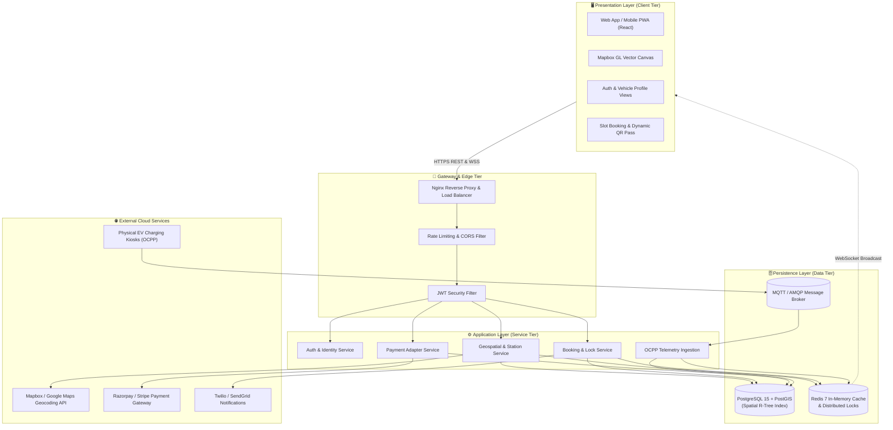
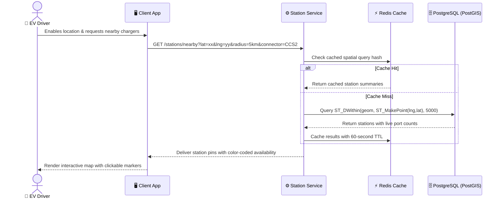
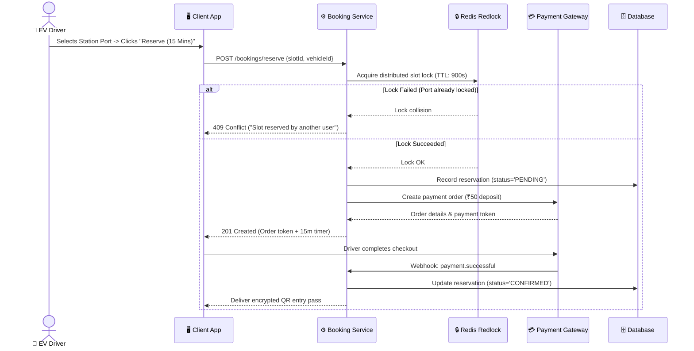

# 🏗️ System Architecture — EV Charging Station Locator

> Complete High-Level and Component-Level Architecture Blueprint for the EV Charging Station Locator Platform.

---

## 📋 Architecture Index & Document Map
This system architecture document is part of the comprehensive Software Engineering Lab suite for **CS311L – Software Engineering and Design Principles**:

| Lab Session | Deliverable Document | Focus Area |
| :--- | :--- | :--- |
| **Session 1** | [Experiment 1: Tools & Version Control](exp1.md) | Collaborative Development, Git/GitHub, Agile SDLC |
| **Session 2** | [Experiment 2: Problem Identification & Feasibility](exp2.md) | Problem Statement, Scope & Feasibility Analysis |
| **Session 3** | [Experiment 3: Requirements Elicitation](exp3.md) | Interviews, Questionnaires, Personas, User Stories |
| **Session 4** | [Experiment 4: IEEE SRS Documentation](exp4.md) | Formal Software Requirement Specification |
| **Session 5** | [Experiment 5: UML Use Case Modeling](exp5.md) | Use Case Diagrams & Operational Narratives |
| **Session 6** | [Experiment 6: UML Class Diagram Design](exp6.md) | Object-Oriented Analysis, Classes & Invariants |
| **Session 7** | [Experiment 7: Dynamic Behavioral Modeling](exp7.md) | Sequence & Activity Workflow Diagrams |
| **Session 8** | [Experiment 8: Software Design Principles](exp8.md) | Modularization, Coupling & Cohesion Analysis |
| **Session 9** | [Experiment 9: Architecture & Design Patterns](exp9.md) | Layered, Microservices & GoF Design Patterns |

---

## 📐 Architecture Overview

The application follows a **multi-tier cloud-native architecture**:

1. **Presentation Layer (Client SPA / PWA)** — Responsive React/TypeScript interface featuring Mapbox GL interactive vector rendering, search filters, and booking sheets.
2. **Gateway & Security Layer** — Reverse proxy, SSL termination, JWT authentication, and API rate limiting.
3. **Application Layer (Business Logic Services)** — Node.js / Express and Python services managing geospatial queries, distributed 15-minute slot locks, and payment settlements.
4. **Data Persistence & Cache Layer** — PostgreSQL 15 with PostGIS spatial extension for sub-second location bounding box queries, Redis 7 for distributed locks and pub-sub caching, and MQTT for hardware telemetry.

---

## 🔗 High-Level System Architecture Diagram

---

## 📦 Component Breakdown & Service Boundaries

### 1. Presentation Layer (Frontend)

| Component | Technology | Responsibility |
| :--- | :--- | :--- |
| **Interactive Map View** | Mapbox GL JS / Leaflet | Renders GPU-accelerated vector map, station clusters, and custom status pins |
| **Filter & Search Drawer** | React, Tailwind CSS | Multi-criteria filtering by connector type (CCS2, Type 2), power (kW), and pricing |
| **Booking & Checkout Modal** | React, Stripe/Razorpay SDK | Manages 15-minute countdown reservation hold and payment authorization |
| **QR Pass Generator** | QR Canvas / Web Crypto | Generates offline-verifiable, dynamic cryptographically signed QR code pass |
| **Operator Console** | React Dashboard | Port health toggle, tariff configuration, and real-time revenue analytics |

### 2. Application Layer (Backend Microservices / Modules)

| Service Module | Endpoints | Responsibility |
| :--- | :--- | :--- |
| **Auth & Profile Service** | `/api/v1/auth/*` | User registration, bcrypt/Argon2 password hashing, JWT token rotation |
| **Station & Geo Service** | `/api/v1/stations/*` | PostGIS spatial queries (`ST_DWithin`), connector filtering, rating aggregates |
| **Booking & Lock Service** | `/api/v1/bookings/*` | Redis-backed distributed slot reservation, concurrency conflict resolution |
| **Payment Service** | `/api/v1/payments/*` | Checkout intent creation, webhook signature verification, digital invoices |
| **Telemetry Ingestion Worker** | MQTT subscriber | Ingests live charger telemetry (voltage, current, socket status) via OCPP |

### 3. Data Persistence Layer

| Datastore | Engine | Primary Usage & Storage Schema |
| :--- | :--- | :--- |
| **Relational & Spatial DB** | PostgreSQL 15 + PostGIS | Station geospatial coordinates, user accounts, vehicle profiles, immutable payment ledgers |
| **In-Memory Cache & Lock** | Redis 7 | 15-minute slot reservation locks (`SET NX PX`), hot station query cache, WebSocket pub-sub |
| **IoT Message Broker** | Eclipse Mosquitto / RabbitMQ | Ingestion queue for high-frequency OCPP hardware status telemetry |

---

## 🔄 End-to-End Dynamic Interaction Flows

### A. Geospatial Discovery Sequence

### B. Slot Reservation & Atomic Settlement Sequence

---

## 🧩 Architectural Design Patterns Applied

| Pattern | Category | Context & Project Implementation |
| :--- | :--- | :--- |
| **Singleton Pattern** | Creational | Shared connection pooling for PostgreSQL and Redis clients to eliminate socket overhead |
| **Factory Method Pattern** | Creational | `PaymentGatewayFactory` instantiating regional payment adapters (`StripeAdapter`, `RazorpayAdapter`) |
| **Adapter Pattern** | Structural | Standardized `IMapProvider` abstracting Mapbox, Google Maps, and OpenStreetMap implementations |
| **Facade Pattern** | Structural | `BookingFacade` orchestrating slot validation, payment hold, and notification delivery |
| **Observer Pattern** | Behavioral | Real-time WebSocket pub-sub pushing station availability mutations to client maps |
| **Strategy Pattern** | Behavioral | Dynamic tariff algorithm calculating peak/off-peak rates and commercial fleet subsidies |

---

## 🔐 Security & Non-Functional Architecture Safeguards
* **Zero Trust Transport:** Mandatory TLS 1.3 encryption across all public interfaces with strict HSTS policies.
* **Stateless Authorization:** Cryptographically signed JWT access tokens with short TTLs (15 mins) and HTTP-only refresh cookies.
* **PCI-DSS Level 1 Compliance:** Direct browser-to-gateway tokenization; zero raw credit card or banking secrets stored on platform servers.
* **High-Availability Fallbacks:** Redis cache fallback to read-replica database in the event of primary database failover.

---

## 👥 Student & Course Identification
* **Course Code:** CS311L – Software Engineering and Design Principles
* **Project Name:** EV Charging Station Locator
* **Repository Identifier:** `EV-Charging-Station-Locator`
