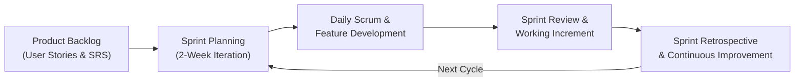
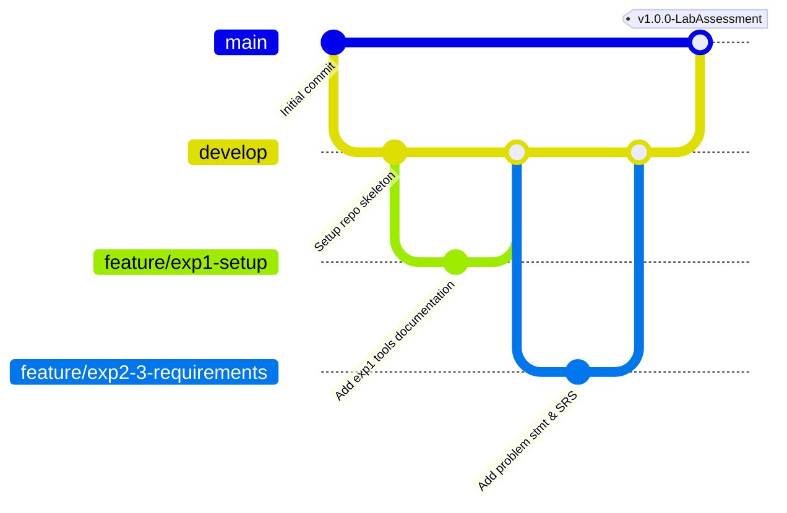

# Experiment 1: Introduction to Software Engineering Tools

## Collaborative Development, Version Control & Project Lifecycle

**Establish the project repository, configure version control workflows with Git and GitHub, define the software project lifecycle model, and establish team formation and project domain selection for the EV Charging Station Locator.**

---

### Aim
To set up a collaborative development environment using Git and GitHub, select an appropriate Software Development Life Cycle (SDLC) model, formulate team responsibilities, and initialize version control for the EV Charging Station Locator project.

---

### Objectives
* Gain practical understanding of Git version control fundamentals (distributed architecture, staging, commits, branches, merges).
* Initialize and configure a remote GitHub repository with branching strategies, collaboration guidelines, and `.gitignore`.
* Evaluate and select an industry-standard Software Development Life Cycle (SDLC) model tailored for iterative development.
* Formulate project domain boundaries and allocate team roles and responsibilities.
* Document version control workflows and establish team collaboration standards.

---

### Introduction
Modern software engineering in industry relies heavily on distributed version control systems (DVCS) and collaborative hosting platforms. Git enables teams to maintain a complete historical record of code changes, experiment safely through isolated feature branches, and merge validated code through peer-reviewed Pull Requests (PRs). Platforms like GitHub augment Git with issue tracking, continuous integration (CI) hooks, branch protection rules, and documentation wikis.

Selecting the right project domain and SDLC framework at the inception stage ensures that development efforts remain aligned with stakeholder goals, manageable in iterations, and resilient to changing requirements.

---

### Selected Project & Domain Details
* **Project Title:** EV Charging Station Locator
* **Course Code:** CS311L – Software Engineering and Design Principles
* **Project Domain:** Green Energy, Smart Mobility, and Intelligent Transportation Systems (ITS)
* **Target Users:** Electric Vehicle (EV) Drivers, Commercial Fleet Operators, Charging Station Operators (CSOs), and City Infrastructure Administrators.

---

### Software Development Life Cycle (SDLC) Model Selection

For the EV Charging Station Locator, the **Agile Scrum Framework** was selected over traditional Waterfall models.

#### Comparative SDLC Analysis

| Evaluation Parameter | Traditional Waterfall | Agile Scrum (Selected) | Rationale for Selection |
| :--- | :--- | :--- | :--- |
| **Requirement Flexibility** | Rigid; frozen at initiation | Highly adaptive; refined per sprint | EV market standards, connector types, and user needs change rapidly |
| **Delivery Model** | Monolithic single release | Incremental, sprint-based releases | Early functional map prototype provides immediate user value |
| **Risk Mitigation** | High late-stage failure risk | Continuous risk reduction | Core features (geolocation, routing) tested early in iterations |
| **Stakeholder Feedback** | At start and final testing | At every sprint review (bi-weekly) | Incorporates driver and station manager usability feedback continuously |
| **Team Collaboration** | Siloed by functional phase | Cross-functional, collaborative | Developers, designers, and testers collaborate daily |

#### Sprint Lifecycle Model



---

### Team Formation and Role Allocation

| Assigned Role | Primary Responsibilities |
| :--- | :--- |
| **Project Lead & Software Architect** | Repository administration, architecture design, SRS documentation, UML modeling, backend APIs, and code reviews |
| **Frontend & UI/UX Developer** | Responsive interface design, map integration (Mapbox/Leaflet), accessibility, client-side validation |
| **QA & Test Engineer** | Test case design, unit testing, integration testing, CI/CD validation, and defect tracking |

---

### Repository Creation & Version Control Workflow

#### 1. Repository Structure
The project repository is structured according to industry best practices, separating documentation, source code, and automated tests:

```
EV-Charging-Station-Locator/
├── .github/
│   └── workflows/              # CI/CD pipelines and PR validation
├── docs/                       # Formal software engineering documentation
│   ├── exp1.md                 # Session 1: Tools & Version Control
│   ├── exp2.md                 # Session 2: Problem Identification & Feasibility
│   ├── exp3.md                 # Session 3: Requirements Elicitation
│   ├── exp4.md                 # Session 4: Software Requirement Specification (SRS)
│   ├── exp5.md                 # Session 5: UML Use Case Modeling
│   ├── exp6.md                 # Session 6: UML Class Diagram Design
│   ├── exp7.md                 # Session 7: Sequence & Activity Diagrams
│   ├── exp8.md                 # Session 8: Software Design Principles Analysis
│   ├── exp9.md                 # Session 9: Software Architecture & Design Patterns
│   └── architecture.md         # Architecture blueprint & specifications
├── src/
│   ├── frontend/               # Interactive map UI & client components
│   └── backend/                # REST API endpoints, routing, controllers
├── test/                       # Unit and integration test suites
├── .gitignore                  # Excluded runtime, OS, and credential artifacts
└── Readme.md                   # Comprehensive project dashboard & setup guide
```

#### 2. Git Branching Model (GitFlow Variant)
To maintain code quality and prevent regressions, the team follows a standard branching workflow:

* `main`: Production-ready, stable codebase. Direct commits are restricted; changes require reviewed Pull Requests.
* `develop`: Integration branch where completed features are merged and tested.
* `feature/<feature-name>`: Isolated branches spawned from `develop` for specific user stories (e.g., `feature/map-view`, `feature/slot-booking`).
* `bugfix/<issue-name>`: Fixes for verified defects during testing.
* `docs/<session-name>`: Documentation and UML modeling updates.



---

### Essential Version Control Commands Reference

| Operation | Git Command | Description & Industry Best Practice |
| :--- | :--- | :--- |
| **Clone Repository** | `git clone <repo-url>` | Downloads remote repository with complete commit history |
| **Create & Switch Branch** | `git checkout -b <branch-name>` | Creates an isolated feature branch off the current branch |
| **Stage Changes** | `git add <files>` | Prepares modified or newly added files for atomic commit |
| **Commit Changes** | `git commit -m "feat: <message>"` | Records staged snapshot with standardized semantic message |
| **Synchronize Remote** | `git pull origin <branch>` | Fetches and integrates latest remote commits |
| **Publish Branch** | `git push origin <branch>` | Pushes local commits to the remote repository |
| **Create Pull Request** | GitHub Web / `gh pr create` | Opens PR for code inspection, CI checks, and review approval |

---

### Observation
Establishing structured version control practices and selecting an Agile framework from the project onset prevents merge conflicts, enhances traceability between user requirements and code, and ensures high visibility across project milestones.

---

### Result
The GitHub repository for the EV Charging Station Locator (`EV-Charging-Station-Locator`) was successfully configured with appropriate directory structures, version control conventions, role allocations, and Agile SDLC definitions.
