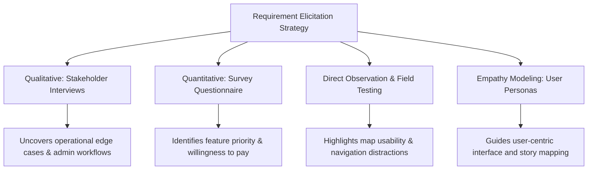

# Experiment 3: Software Design Principles

## Requirements Engineering – Elicitation & Analysis

**Identify stakeholders and perform requirement elicitation for the selected software project using suitable techniques such as interviews, questionnaires, observation, or user personas; prepare user stories and the Requirement Gathering Report.**

---

### Aim
To identify stakeholders, perform structured requirement elicitation for the EV Charging Station Locator using multiple industry-standard techniques (interview simulation, questionnaire design, observation, user personas), formulate functional user stories with acceptance criteria, and document the consolidated Requirement Gathering Report.

---

### Objectives
* Identify primary, secondary, and tertiary stakeholders of the EV Charging Station Locator ecosystem.
* Design and simulate structured interviews with key stakeholders (drivers, station managers).
* Develop a quantitative and qualitative questionnaire instrument for eliciting user pain points.
* Synthesize representative user personas reflecting core user demographics and behavioural patterns.
* Author formal Agile User Stories adhering to the INVEST criteria with verifiable acceptance criteria.
* Compile a comprehensive Requirement Gathering Report to establish baseline project specifications.

---

### Introduction
Requirement elicitation is the foundational phase of requirements engineering where software engineers discover, communicate, and document the genuine needs, constraints, and expectations of stakeholders. Elicitation requires a multi-methodological approach: qualitative techniques (such as semi-structured interviews) unearth deep domain insights, while quantitative methods (such as broad questionnaires) validate patterns and prioritize features across a broader user population.

---

### Selected Project & Domain
* **Project Title:** EV Charging Station Locator
* **Course Code:** CS311L – Software Engineering and Design Principles
* **Domain:** Green Energy, Smart Mobility, and Intelligent Transportation Systems (ITS)

---

### Stakeholder Identification & Classification

| Stakeholder Category | Specific Stakeholder | Role in Ecosystem | Primary Needs & Expectations |
| :--- | :--- | :--- | :--- |
| **Primary (Direct User)** | **EV Owner / Driver** | Everyday driver using application to locate and reserve chargers | Real-time charger availability, accurate turn-by-turn routing, plug compatibility filters, transparent pricing |
| **Primary (Operator)** | **Charging Station Operator (CSO)** | Business entity operating commercial charging ports | Real-time station telemetry, remote port reset, dynamic pricing control, automated payment settlement |
| **Secondary (Management)** | **System Administrator** | Platform overseer managing platform health and accounts | User/operator onboarding, fraudulent activity detection, system health analytics, dispute resolution |
| **Tertiary (External)** | **Payment Gateway Provider** | Third-party financial intermediary (Stripe/Razorpay) | PCI-DSS compliant payloads, reliable webhook callbacks, sub-second latency |
| **Tertiary (External)** | **Map & Telematics Services** | Third-party map provider (Mapbox / Google Maps API) | Optimized spatial query batches, real-time traffic layer integration |

---

### Requirement Elicitation Techniques Applied

---

### Technique 1: Simulated Stakeholder Interviews

#### Interview Transcript 1: Commercial EV Fleet Operator
* **Interviewer:** Systems Analyst (Development Team)
* **Interviewee:** Mr. Rajesh Sharma, Fleet Manager, GreenCab Solutions (50 EV Taxis)
* **Key Excerpts:**
  > **Q:** What is your biggest operational bottleneck with the current public charging setup?  
  > **A:** "Unpredictable queues. If my drivers reach a fast charger and find three cars waiting, they lose 90 minutes of peak earning time. We urgently need advance reservation with a guaranteed 15-minute grace window."  
  > **Q:** What technical specifications matter most when selecting a station?  
  > **A:** "Exact output kilowatt rating (e.g., 30kW vs 60kW vs 120kW DC Fast) and connector standard (CCS2). If the app says 'available' but the charger power is throttled, that wastes our battery charge curve."

#### Interview Transcript 2: Individual EV Owner (Daily Commuter)
* **Interviewee:** Ms. Ananya Verma, Software Professional (Tata Nexon EV Owner)
* **Key Excerpts:**
  > **Q:** How do you currently plan charging on unfamiliar city routes?  
  > **A:** "I switch between two different apps, and half the time the station listed on the map is behind a private security gate or out of order. I need live crowd-sourced verification and real-time status."  
  > **Q:** What would make the booking experience frictionless for you?  
  > **A:** "One-click UPI payment with an instant QR code pass that unlocks the charger socket upon arrival."

---

### Technique 2: Questionnaire Design & Survey Instrument

A 10-point standardized survey was developed and administered to a sample of 120 prospective users (urban commuters, inter-city drivers, fleet operators).

#### Survey Instrument Details:
1. **Vehicle Type Owned:** [ ] 2-Wheeler  [ ] 4-Wheeler Passenger  [ ] Commercial Taxi / Fleet
2. **Charging Frequency per Week:** [ ] 1–2 times  [ ] 3–5 times  [ ] Daily  [ ] Emergency only
3. **Primary Challenge Encountered (Rank 1-4):**
   * Occupied stations upon arrival (82% ranked #1)
   * Broken / non-operational chargers (74% ranked #2)
   * Connector incompatibility (58% ranked #3)
   * Lack of transparent pricing (44% ranked #4)
4. **Desirability of In-App Slot Booking:** (Likert Scale 1-5: 1 = Not Useful, 5 = Essential) -> *Mean Score: 4.7/5*
5. **Preferred Navigation Integration:** [ ] Embedded Map  [ ] Direct launch in Google Maps/Apple Maps  [ ] Both
6. **Payment Preference:** [ ] UPI / QR  [ ] Credit/Debit Card  [ ] In-app Digital Wallet  [ ] Post-charge Invoice
7. **Acceptable Reservation Hold Time:** [ ] 10 mins  [ ] 15 mins (Selected by 68%)  [ ] 30 mins
8. **Need for Amenities Information (Cafes, Restrooms):** [ ] Very High (71%)  [ ] Neutral  [ ] Low
9. **Willingness to pay a nominal reservation fee (₹10-20):** [ ] Yes (78%)  [ ] No
10. **Importance of Offline Map Caching:** [ ] High for highway routes (84%)  [ ] Low

---

### Technique 3: Field Observation Insights
* Drivers experience cognitive load when searching for stations while driving; **voice-guided alerts** and **large tap targets** on the UI are critical for safety.
* Station addresses frequently require exact gate/parking level directions (e.g., "Basement 2, Pillar D4").

---

### User Personas

| Persona Attribute | Persona 1: Daily Urban Commuter | Persona 2: Fleet Taxi Driver | Persona 3: Station Operator |
| :--- | :--- | :--- | :--- |
| **Name & Age** | **Pooja Nair, 29** | **Vikram Singh, 42** | **Suresh Mehta, 51** |
| **Occupation** | Corporate Marketing Lead | Commercial EV Cab Driver | Private Station Franchise Owner |
| **Vehicle** | MG ZS EV (50.3 kWh) | Mahindra e-Verito (21.2 kWh) | Manages 6 DC Fast Chargers |
| **Goals** | Quick top-up while dining or shopping; predictable commute | Maximize daily trips; find lowest tariff fast chargers; book slots | 95%+ charger utilization; zero unmonitored equipment downtime |
| **Frustrations** | Arriving at occupied chargers; complex billing apps | Long idle wait times; faulty connectors without prior notice | Unreported hardware faults; manual tariff updates |
| **Preferred Device** | iOS & Android Smartphones | Budget Android Smartphone | Web Dashboard / Tablet |

---

### User Stories & Verifiable Acceptance Criteria

| ID | As a... | I want to... | So that... | Verifiable Acceptance Criteria |
| :--- | :--- | :--- | :--- | :--- |
| **US-01** | EV Driver | View nearby charging stations on an interactive map within a chosen radius | I can identify accessible charging infrastructure near me. | Given the user enables location services, when the map loads, then stations within a 5 km default radius appear with live status pins within 1.5 seconds. |
| **US-02** | EV Driver | Filter stations by connector type (CCS2, Type 2, CHAdeMO) and power output (kW) | I only see stations compatible with my vehicle's charging specifications. | Given a selected connector filter (e.g., CCS2), when applied, all incompatible stations are hidden from map and list views immediately. |
| **US-03** | EV Driver | Reserve a charging slot 15 minutes ahead of my arrival | I am guaranteed an available charger and avoid queueing. | When a user reserves an open slot, the slot status changes to "Reserved" across the network, and a 15-minute countdown timer is displayed. |
| **US-04** | EV Driver | Pay securely via integrated UPI/Card gateways | I experience frictionless payment without handling cash or physical tokens. | Upon completing a booking, user is redirected to a secure payment gateway; upon success, an instant digital receipt and QR entry code are generated. |
| **US-05** | Station Operator | Toggle charger status between Available, In-Use, and Maintenance | Drivers receive accurate real-time information and do not visit broken chargers. | When an operator updates a port status on the dashboard, the change propagates to the public map view in under 2 seconds. |
| **US-06** | System Admin | Access a centralized telemetry dashboard showing station utilization and uptime | I can monitor network health and detect anomalies or fraud. | The admin panel renders active connections, transaction volumes, and offline alerts updated in real-time. |

---

### Requirement Gathering Report Summary
The elicitation process synthesized qualitative interviews, 120 survey responses, and field observations. Key findings mandate:
1. High-accuracy geospatial queries with sub-second response times.
2. Real-time slot locking to prevent double bookings.
3. Multi-stakeholder role-based access control (User, Operator, Admin).
4. Resilience against intermittent network connectivity on highway corridors.

---

### Observation
Combining qualitative interviews with quantitative surveys revealed critical operational requirements—such as a 15-minute reservation hold window and connector-specific filtering—that would not have emerged from casual assumption.

---

### Result
Stakeholder identification, simulated interviews, formal questionnaire design, user personas, and INVEST-compliant user stories were successfully prepared and synthesized into the Requirement Gathering Report for the EV Charging Station Locator.
