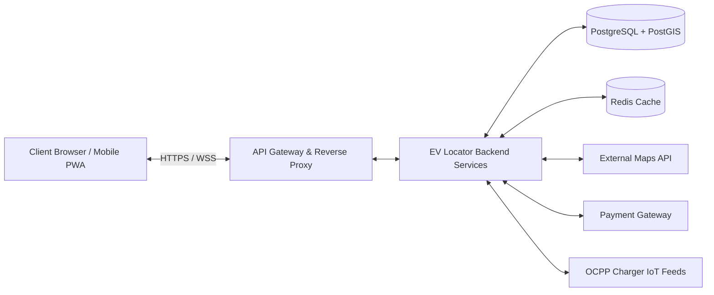

# Experiment 4: Software Requirement Specification (SRS)

## Formal SRS Documentation (IEEE Std 830-1998 / ISO/IEC/IEEE 29148 Standard)

**Prepare a comprehensive Software Requirement Specification (SRS) document for the EV Charging Station Locator following the IEEE SRS standard format, detailing functional and non-functional requirements, external interfaces, and system constraints.**

---

### Aim
To author a formal, complete, unambiguous Software Requirement Specification (SRS) document for the EV Charging Station Locator system conforming to the IEEE Std 830-1998 / ISO/IEC/IEEE 29148 standards.

---

### Objectives
* Establish formal project boundaries, system purpose, and conventions.
* Document functional requirements with rigorous input, processing, and output specifications.
* Specify non-functional requirements covering performance, security, availability, and usability.
* Define external interface requirements (UI, hardware, third-party software, communication protocols).
* Provide baseline specifications for verification, validation, and acceptance testing.

---

# SOFTWARE REQUIREMENT SPECIFICATION (SRS)
## Project: EV Charging Station Locator (SmartCharge Locator)
**Version:** 1.0  
**Course:** CS311L – Software Engineering and Design Principles  

---

### Table of Contents
1. **Introduction**
   * 1.1 Purpose
   * 1.2 Document Conventions
   * 1.3 Intended Audience and Reading Suggestions
   * 1.4 Product Scope
   * 1.5 References
2. **Overall Description**
   * 2.1 Product Perspective
   * 2.2 Product Functions
   * 2.3 User Classes and Characteristics
   * 2.4 Operating Environment
   * 2.5 Design and Implementation Constraints
   * 2.6 User Documentation
   * 2.7 Assumptions and Dependencies
3. **External Interface Requirements**
   * 3.1 User Interfaces
   * 3.2 Hardware Interfaces
   * 3.3 Software Interfaces
   * 3.4 Communications Interfaces
4. **System Features & Functional Requirements**
   * 4.1 User Authentication & Profile Management
   * 4.2 Interactive Geospatial Station Discovery
   * 4.3 Multi-Criteria Filter & Search Engine
   * 4.4 Real-Time Charger Status & Availability
   * 4.5 Slot Reservation & Holding System
   * 4.6 Payment Gateway Integration & Digital Receipts
   * 4.7 Route Navigation & Wayfinding
   * 4.8 Station Operator Telemetry & Management
   * 4.9 Crowd-Sourced Reviews & Rating System
   * 4.10 System Administration & Platform Auditing
5. **Non-Functional Requirements**
   * 5.1 Performance Requirements
   * 5.2 Safety Requirements
   * 5.3 Security Requirements
   * 5.4 Software Quality Attributes (Availability, Reliability, Maintainability, Usability)
   * 5.5 Business Rules & Legal Compliance

---

### 1. Introduction

#### 1.1 Purpose
The purpose of this document is to specify all functional, non-functional, and interface requirements for the **EV Charging Station Locator** web application. This specification acts as a binding contract between end-users, station operators, software architects, developers, and test engineers throughout the system lifecycle.

#### 1.2 Document Conventions
* All requirement identifiers follow the syntax: `[FR-XX]` for Functional Requirements and `[NFR-XX]` for Non-Functional Requirements.
* Priority levels are denoted as:
  * **High (H):** Mandatory for MVP release.
  * **Medium (M):** Planned for secondary sprint.
  * **Low (L):** Desirable enhancement.

#### 1.3 Intended Audience and Reading Suggestions
* **Developers & Architects:** Focus on Sections 3, 4, and 5 for architectural patterns and API boundaries.
* **Testers & QA:** Reference Section 4 and 5 to formulate test matrices and acceptance criteria.
* **Project Evaluators / Instructors:** Review Section 1 and 2 for alignment with lab curriculum.

#### 1.4 Product Scope
The EV Charging Station Locator is a cloud-native, responsive web system providing real-time location mapping of electric vehicle charging stations, connector compatibility filtering, slot reservation, integrated UPI/Card billing, and station telemetry monitoring. Physical charger hardware manufacturing and grid load distribution are outside system scope.

#### 1.5 References
* IEEE Std 830-1998, *IEEE Recommended Practice for Software Requirements Specifications*.
* ISO/IEC/IEEE 29148:2018, *Systems and software engineering — Life cycle processes — Requirements engineering*.
* Open Charge Point Protocol (OCPP 1.6 / 2.0.1) Standards.

---

### 2. Overall Description

#### 2.1 Product Perspective
The EV Charging Station Locator is an autonomous, self-contained multi-tier web application that interfaces with external mapping systems (Mapbox/Google Maps), third-party payment gateways (Razorpay/Stripe), and remote IoT charging controllers via RESTful and WebSocket protocols.

#### 2.2 Product Functions
* Interactive rendering of nearby charging stations centered on user coordinates.
* Detailed station profile inspection (available slots, pricing per kWh, operating hours, photos).
* Real-time slot locking with guaranteed 15-minute reservation timer.
* Integrated checkout generating dynamic QR code charging passes.
* Operator telemetry dashboard for port management and tariff configuration.

#### 2.3 User Classes and Characteristics
* **EV Driver (Unauthenticated):** Can browse public maps and filter stations; cannot reserve slots or submit reviews.
* **Registered EV Driver:** Full access to booking, payment, favorites, charging history, and feedback.
* **Charging Station Operator (CSO):** Can register stations, monitor port health, manage pricing, and view revenue.
* **Platform Administrator:** Global control over platform accounts, dispute audits, and system metrics.

#### 2.4 Operating Environment
* **Client Side:** Modern web browsers (Google Chrome 110+, Mozilla Firefox 115+, Safari 16+, Microsoft Edge) supporting HTML5 Geolocation.
* **Server Side:** Node.js (v20 LTS) / Python (3.11+) runtimes hosted on Ubuntu 22.04 LTS / Docker containerization.
* **Database:** PostgreSQL 15 with PostGIS extension for geospatial operations and Redis 7 for cache/pub-sub.

#### 2.5 Design and Implementation Constraints
* Compliance with PCI-DSS Level 1 specifications for handling financial tokens (no raw credit card data stored locally).
* Adherence to Open Charge Point Protocol (OCPP) data models for charging station parameters.
* Response time under 1.5 seconds for geospatial radius queries over 10,000 station records.

#### 2.6 User Documentation
An integrated web help center, onboarding wizard for first-time drivers, and OpenAPI/Swagger API documentation for station operators.

#### 2.7 Assumptions and Dependencies
* Users possess GPS-enabled mobile devices or grant geolocation browser permissions.
* Third-party map and geocoding services maintain 99.9% uptime SLA.

---

### 3. External Interface Requirements

#### 3.1 User Interfaces
* Responsive mobile-first interface designed with CSS grid/flexbox.
* High-contrast map markers color-coded by real-time status: **Green** (Available), **Amber** (Partially Occupied), **Red** (Fully Occupied), **Grey** (Offline/Maintenance).
* Modal checkout dialog with countdown timer for slot reservation.

#### 3.2 Hardware Interfaces
* Client GPS receivers for high-precision latitude/longitude coordinates (accuracy within 10 meters).
* Optional optical QR barcode scanners at physical charging kiosks to validate digital booking passes.

#### 3.3 Software Interfaces
* **Geocoding & Maps API:** Mapbox GL JS / Google Maps JavaScript API for tiles and route calculation.
* **Payment Gateway API:** Razorpay / Stripe REST APIs for order creation, signatures, and webhook refunds.
* **SMS / Email Service:** SendGrid / Twilio API for automated OTP generation and booking confirmations.

#### 3.4 Communications Interfaces
* HTTPS with TLS 1.3 encryption across all public REST endpoints.
* Secure WebSockets (`wss://`) for bidirectional real-time status broadcasting.
* JSON payload format for all API exchanges.

---

### 4. System Features & Functional Requirements

#### 4.1 User Authentication & Profile Management
* **[FR-1.1]** System shall allow users to register using email/password or OAuth 2.0 (Google/Apple).
* **[FR-1.2]** System shall hash passwords using Argon2id / bcrypt with minimum cost factor of 12.
* **[FR-1.3]** System shall issue signed JWT access tokens (15-min lifespan) and HTTP-only refresh tokens.
* **[FR-1.4]** Users shall manage personal vehicle profiles (Make, Model, Battery Capacity, Connector Standard).

#### 4.2 Interactive Geospatial Station Discovery
* **[FR-2.1]** The system shall acquire user coordinates via HTML5 Geolocation API upon explicit consent.
* **[FR-2.2]** System shall query database using PostGIS spatial indexing (`ST_DWithin`) to return all stations within user-selected radius (default: 5 km, up to 50 km).
* **[FR-2.3]** Map markers shall display real-time port status clusters with automatic zoom grouping.

#### 4.3 Multi-Criteria Filter & Search Engine
* **[FR-3.1]** Users shall filter stations by connector type: CCS2, Type 2 AC, CHAdeMO, GB/T, Tesla NACS.
* **[FR-3.2]** Users shall filter by charging speed: Slow (<= 7.4 kW), Fast (11–22 kW), Rapid DC (>= 50 kW).
* **[FR-3.3]** Users shall filter by pricing, operator brand, 24x7 open status, and on-site amenities (Cafe, Restroom, Wi-Fi).

#### 4.4 Real-Time Charger Status & Availability
* **[FR-4.1]** System shall display total vs occupied slots per station (e.g., "3 of 4 ports available").
* **[FR-4.2]** Status changes reported by operators or telemetry shall reflect on client maps in under 2 seconds.

#### 4.5 Slot Reservation & Holding System
* **[FR-5.1]** Drivers shall select an available charging port and reserve a 30-minute charging window.
* **[FR-5.2]** The system shall lock the selected slot for 15 minutes awaiting user arrival and payment.
* **[FR-5.3]** If the user fails to initiate charging within the 15-minute grace period, the slot shall automatically release back to public inventory.

#### 4.6 Payment Gateway Integration
* **[FR-6.1]** System shall calculate estimated cost based on tariff per kWh or hourly parking fee.
* **[FR-6.2]** System shall initiate secure payment orders via Razorpay/Stripe and verify webhook signatures.
* **[FR-6.3]** Upon payment confirmation, the system shall generate an encrypted QR code booking token.

#### 4.7 Route Navigation & Wayfinding
* **[FR-7.1]** The system shall compute the shortest route from driver coordinates to the chosen station.
* **[FR-7.2]** The system shall offer deep-linking into native mobile navigation apps (Google Maps, Apple Maps, Waze).

#### 4.8 Station Operator Management
* **[FR-8.1]** Verified operators shall register new charging stations with location coordinates and port specs.
* **[FR-8.2]** Operators shall modify dynamic hourly tariffs and schedule maintenance downtime.

#### 4.9 Reviews & Feedback
* **[FR-9.1]** Verified users who completed a charging session can submit a 1–5 star rating and textual review.
* **[FR-9.2]** Drivers can report inaccurate status, damaged plugs, or blocked bays.

#### 4.10 Admin Monitoring & Auditing
* **[FR-10.1]** Admins can approve or suspend operator accounts and monitor system logs.
* **[FR-10.2]** System shall retain tamper-proof audit trails for all financial transactions for 7 years.

---

### 5. Non-Functional Requirements

#### 5.1 Performance Requirements
* **[NFR-1.1] Geospatial Query Latency:** Map queries within 10 km shall return results within 500 ms for up to 500 simultaneous requests.
* **[NFR-1.2] Throughput:** Backend shall sustain a minimum of 200 transactions per second (TPS).
* **[NFR-1.3] Page Load Time:** First Contentful Paint (FCP) shall occur within 1.2 seconds over 4G connections.

#### 5.2 Safety Requirements
* **[NFR-2.1]** UI elements must meet minimum size guidelines (48x48 dp) and voice cues to prevent distracted driving.
* **[NFR-2.2]** Emergency disconnection guides and safety helpline numbers must be prominently visible on station profiles.

#### 5.3 Security Requirements
* **[NFR-3.1]** All traffic must be secured via HTTPS (TLS 1.3) with HSTS headers enabled.
* **[NFR-3.2]** Token storage must utilize HTTP-only, secure, SameSite cookies to mitigate XSS and CSRF attacks.
* **[NFR-3.3]** Rate limiting: API endpoints shall throttle requests exceeding 60 calls per minute per IP.

#### 5.4 Software Quality Attributes
* **Availability:** System shall achieve 99.9% uptime excluding scheduled maintenance.
* **Reliability:** Mean Time Between Failures (MTBF) shall exceed 720 operating hours.
* **Maintainability:** Modular layered architecture with automated unit test coverage exceeding 80%.
* **Portability:** Fully responsive on desktop, tablet, and mobile screens (viewport widths 320px to 3840px).

---

### Observation
Documenting rigorous functional and non-functional requirements in standard IEEE format eliminates developer ambiguity, prevents scope creep, and establishes transparent test criteria for lab evaluation.

---

### Result
The complete IEEE Std 830-compliant Software Requirement Specification (SRS) for the EV Charging Station Locator project was formulated and successfully documented.
