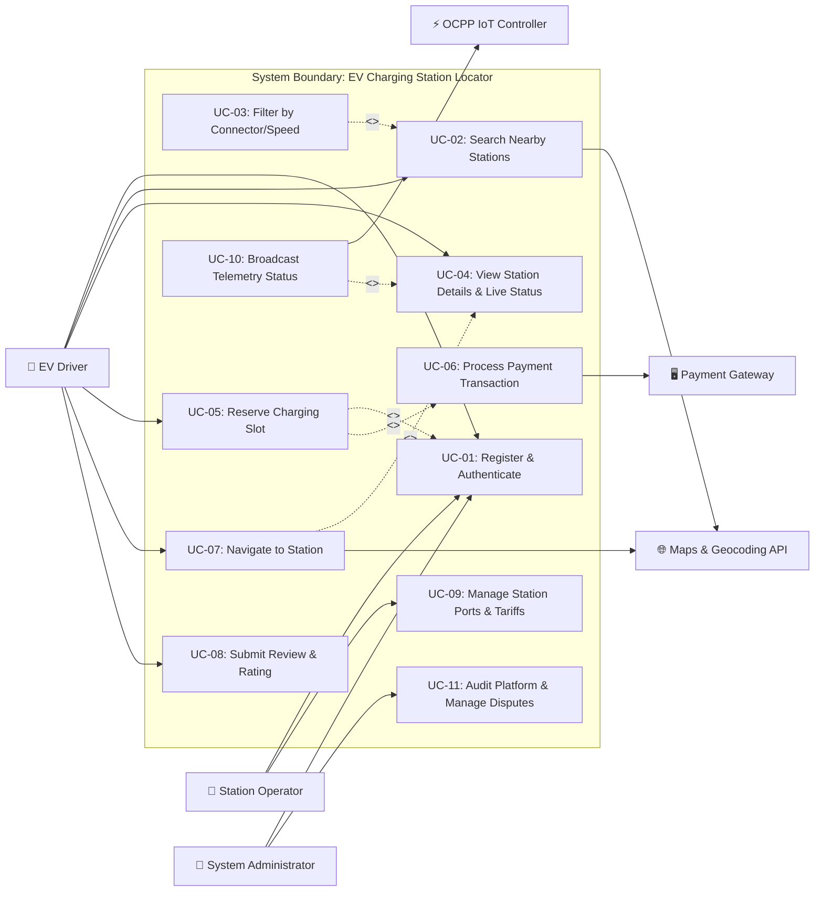

# Experiment 5: UML Use Case Modeling

## Requirements Modeling & Functional Flow Specifications

**Identify system actors and use cases, design a comprehensive UML Use Case Diagram, and prepare structured Use Case Description Narratives for the EV Charging Station Locator system.**

---

### Aim
To perform object-oriented functional modeling by identifying primary and supporting actors, defining system use case boundaries, constructing UML Use Case Diagrams using standard notations, and documenting detailed Use Case Narratives for the EV Charging Station Locator.

---

### Objectives
* Identify human and external system actors interacting with the EV Charging Station Locator.
* Identify core functional use cases spanning driver, station operator, and administrative workflows.
* Construct a UML Use Case Diagram illustrating `<<include>>` and `<<extend>>` relationships.
* Develop standardized Use Case Description Templates covering preconditions, main success scenarios, alternate flows, and postconditions.
* Validate requirements completeness against the IEEE SRS specification.

---

### Introduction
Use Case Modeling is an essential requirement modeling technique in the Unified Modeling Language (UML). It provides an outside-in, user-centric perspective of system functionality. A use case defines a sequence of interactions between one or more actors and the system to achieve an observable goal of value. 

In industrial practice, use cases serve as the foundational bridge between formal requirements (SRS) and structural/behavioral system design (Class and Sequence diagrams).

---

### Actor Identification & Categorization

| Actor Name | Type | Description |
| :--- | :--- | :--- |
| **EV Driver** | Primary (Human) | The end-user driving an electric vehicle who searches, filters, reserves, navigates to, and pays for charging sessions. |
| **Station Operator** | Primary (Human) | Franchise owner or station manager responsible for managing charger ports, pricing tariffs, and reviewing station revenue. |
| **System Administrator** | Secondary (Human) | Platform supervisor who approves operator accounts, manages dispute resolutions, and audits system logs. |
| **Payment Gateway** | Supporting (External System) | Third-party PCI-DSS compliant financial service (Razorpay/Stripe) that authorizes card/UPI transactions and triggers webhooks. |
| **Maps / Geolocation Service** | Supporting (External System) | Mapbox / Google Maps API providing vector tiles, route calculation, geocoding, and distance matrix computations. |
| **IoT Charger Telemetry Feed** | Supporting (External System) | Embedded hardware controllers transmitting port live status (Available, Charging, Faulted) via OCPP 1.6/2.0 protocols. |

---

### Use Case Identification & Summary

| Use Case ID | Use Case Name | Primary Actor | Description | Relationships |
| :--- | :--- | :--- | :--- | :--- |
| **UC-01** | Register / Login | EV Driver / Operator | Authenticates user via email/password or OAuth | Base use case |
| **UC-02** | Search Nearby Stations | EV Driver | Finds charging stations based on GPS or address | `<<include>>` Geolocation Query |
| **UC-03** | Filter & Sort Stations | EV Driver | Refines stations by connector, power, price | `<<extend>>` Search Stations |
| **UC-04** | View Station Details & Availability | EV Driver | Displays live ports, tariffs, and amenities | Base use case |
| **UC-05** | Reserve Charging Slot | EV Driver | Locks a charging port for a 15-minute window | `<<include>>` Authenticate; `<<include>>` Process Payment |
| **UC-06** | Process Payment | Payment Gateway | Authorizes billing transaction via UPI/Card | Included by UC-05 |
| **UC-07** | Navigate to Station | EV Driver | Computes turn-by-turn directions to station | `<<include>>` Map Routing API |
| **UC-08** | Submit Rating & Review | EV Driver | Posts feedback after completed session | `<<extend>>` View Station Details |
| **UC-09** | Manage Station Ports & Tariffs | Station Operator | Configures hardware ports, rates, maintenance | Base use case |
| **UC-10** | Broadcast Telemetry Status | IoT Controller | Pushes real-time charger availability updates | Base use case |
| **UC-11** | Audit Platform & Resolve Disputes | System Admin | Oversees platform health and resolves issues | Base use case |

---

### UML Use Case Diagram

---

### Detailed Use Case Narratives (Standard Templates)

#### Use Case Narrative 1: Reserve Charging Slot (UC-05)

| Field | Specification |
| :--- | :--- |
| **Use Case ID** | **UC-05** |
| **Use Case Name** | Reserve Charging Slot |
| **Primary Actor** | Registered EV Driver |
| **Secondary Actor** | Payment Gateway, Station Inventory Controller |
| **Trigger** | Driver clicks "Reserve Now" on an available charging port |
| **Preconditions** | 1. Driver is logged in to a verified account. 2. Selected charging station has at least one port marked "Available". 3. Driver has added vehicle specifications (connector compatibility verified). |
| **Postconditions** | 1. Port status transitions to "Reserved" for 15 minutes. 2. Slot lock prevents double booking. 3. Digital Booking Pass with dynamic QR code is issued. 4. Payment receipt is emailed to the driver. |
| **Main Success Scenario** | 1. Driver selects target station and clicks an available charging port. 2. System displays reservation details (connector standard, tariff per kWh, 15-min hold window, estimated deposit). 3. Driver confirms booking details. 4. System invokes `<<include>>` UC-06: Process Payment. 5. Payment Gateway authorizes the transaction and returns a successful response. 6. System places a temporary lock on the port and starts a 15-minute countdown timer. 7. System generates an encrypted QR pass and displays navigation options. |
| **Alternative Flows** | **Alt 5a: Payment Declined** 1. Payment gateway reports card expired or UPI timeout. 2. System notifies driver with specific error message. 3. Driver selects alternate payment method within 2 minutes. 4. If payment fails again, port lock is released and use case terminates.  **Alt 6a: Slot Taken Concurrently (Race Condition)** 1. Another user locks the port milliseconds earlier. 2. System rolls back transaction, alerts driver, and presents next available port at the same station. |
| **Special Requirements** | Response time for lock acquisition must be under 300 ms to avoid distributed race conditions. |

---

#### Use Case Narrative 2: Search & Filter Stations (UC-02 & UC-03)

| Field | Specification |
| :--- | :--- |
| **Use Case ID** | **UC-02 & UC-03** |
| **Use Case Name** | Search Nearby Stations with Multi-Criteria Filters |
| **Primary Actor** | EV Driver (Guest or Registered) |
| **Secondary Actor** | Maps API, Spatial Database Engine |
| **Preconditions** | Device GPS is enabled or user has typed an address in the search field. |
| **Postconditions** | Map and list views display all matching stations within the specified radius. |
| **Main Success Scenario** | 1. Driver opens locator screen. 2. System requests current coordinates via browser Geolocation API. 3. Driver grants permission. 4. System queries spatial database for stations within default 5 km radius. 5. System renders interactive map pins color-coded by real-time status. 6. *(Optional - UC-03)* Driver opens filter drawer and selects "CCS2" connector and ">= 50 kW Fast". 7. System dynamically recalculates matching pins without page reload. 8. Driver taps a pin to view summary bubble (distance, available ports, rate). |
| **Alternative Flows** | **Alt 3a: Location Permission Denied** 1. System prompts driver to enter city, postal code, or landmark manually. 2. System queries geocoding service to retrieve coordinates. 3. Flow resumes from step 4. |

---

#### Use Case Narrative 3: Manage Station Ports & Tariffs (UC-09)

| Field | Specification |
| :--- | :--- |
| **Use Case ID** | **UC-09** |
| **Use Case Name** | Manage Station Ports & Tariffs |
| **Primary Actor** | Station Operator |
| **Preconditions** | Operator is authenticated with role `STATION_OPERATOR`. |
| **Postconditions** | Updated port parameters or hourly tariffs are saved and pushed to public map views. |
| **Main Success Scenario** | 1. Operator accesses station management dashboard. 2. System lists all registered stations belonging to the operator. 3. Operator selects a station and clicks "Port Configuration". 4. Operator updates status of Port #2 to "Under Maintenance" due to physical wear. 5. Operator modifies off-peak tariff rate. 6. Operator clicks "Save & Publish". 7. System validates input, updates PostgreSQL database, invalidates Redis cache, and broadcasts event via WebSocket to connected clients. |

---

### Observation
Use case modeling successfully demarcated system boundaries, revealed critical `<<include>>` relationships (such as locking inventory before confirming payment), and created unambiguous testable requirements.

---

### Result
Primary and supporting actors were identified, a comprehensive UML Use Case Diagram was modeled, and detailed operational narratives were documented for the EV Charging Station Locator.
