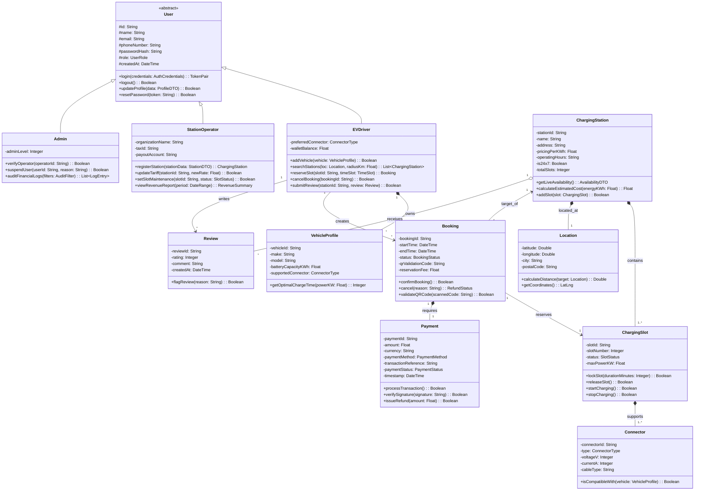

# Experiment 6: UML Class Diagram Design

## Object-Oriented Analysis & Structural System Design

**Perform Object-Oriented Analysis (OOA) on the EV Charging Station Locator system, identify classes, attributes, methods, access visibilities, and relationships, and construct a comprehensive UML Class Diagram.**

---

### Aim
To analyze the EV Charging Station Locator domain using object-oriented principles, identify entities and their encapsulation boundaries, establish inheritance, association, aggregation, and composition relationships, and construct a formal UML Class Diagram.

---

### Objectives
* Perform Object-Oriented Analysis (OOA) to decompose domain requirements into modular classes.
* Define appropriate attributes, data types, visibility modifiers (`+` public, `-` private, `#` protected), and operations with signatures.
* Model structural relationships including Generalization/Inheritance, Composition, Aggregation, and Association with explicit multiplicities.
* Construct an industry-standard UML Class Diagram using Mermaid.
* Document a Class Data Dictionary defining class responsibilities, collaborators, and invariants.

---

### Introduction
Object-Oriented Analysis and Design (OOAD) organizes software around real-world concepts and abstractions rather than procedural functions. A UML Class Diagram represents the static structural architecture of an object-oriented system, showing the classes, their internal data encapsulated behind methods, and the relationships connecting them.

In an EV charging platform, clean structural modeling is paramount: hardware assets (stations, slots, connectors) must maintain strict integrity, while transactional lifecycles (bookings, sessions, invoices) must ensure thread-safety and audit compliance.

---

### Object-Oriented Analysis & Class Identification

The system domain is decomposed into four functional clusters:
1. **User Management & Identity:** Base abstract `User`, specialized `EVDriver`, `StationOperator`, `Admin`, and `VehicleProfile`.
2. **Charging Infrastructure Hierarchy:** `ChargingStation`, `ChargingSlot`, `Connector`, and `Location`.
3. **Transaction & Lifecycle Management:** `Booking`, `Payment`, `Invoice`, and `ChargingSession`.
4. **Service & Engine Interfaces:** `StationService`, `BookingEngine`, `RouteCalculator`, and `PaymentGateway`.

---

### UML Class Diagram

---

### Relationship Analysis & Justification

| Relationship Type | Source Class | Target Class | UML Multiplicity | Architectural Justification |
| :--- | :--- | :--- | :--- | :--- |
| **Generalization (Inheritance)** | `User` | `EVDriver`, `StationOperator`, `Admin` | `1 : 1` | `User` encapsulates common authentication credentials and lifecycle methods, while subclasses extend specialized role behavior. |
| **Composition** | `ChargingStation` | `ChargingSlot` | `1 : 1..*` | A slot physically resides inside a station. If a station is decommissioned, its slots cannot exist independently (lifecycle dependency). |
| **Composition** | `ChargingSlot` | `Connector` | `1 : 1..*` | Physical plugs are hardwired into the charging dispenser unit. |
| **Composition** | `ChargingStation` | `Location` | `1 : 1` | Every physical station has exactly one immutable geospatial coordinate point. |
| **Aggregation** | `ChargingStation` | `Review` | `1 : 0..*` | Reviews belong to a station, but driver reviews can persist for auditing even if a station temporarily closes. |
| **Association** | `EVDriver` | `Booking` | `1 : 0..*` | A driver may create multiple historical reservations over time. |
| **Composition** | `Booking` | `Payment` | `1 : 1` | A reservation record holds exactly one financial settlement record. |

---

### Class Specifications & Data Dictionary

#### 1. `ChargingStation`
* **Responsibilities:** Maintains station profile, geographical coordinates, hourly pricing tariffs, aggregate rating, and provides real-time query interface for available slots.
* **Key Attributes:**
  * `- stationId: String [PK]` – Globally unique station identifier.
  * `- pricingPerKWh: Float` – Dynamic tariff rate in local currency.
  * `- is24x7: Boolean` – Flag indicating whether station operates continuously.
* **Invariants:** `totalSlots > 0`, `pricingPerKWh >= 0.0`.

#### 2. `ChargingSlot`
* **Responsibilities:** Manages port-level state machine transitions: `AVAILABLE` -> `RESERVED` -> `CHARGING` -> `MAINTENANCE`.
* **Key Operations:**
  * `+ lockSlot(durationMinutes: Integer): Boolean`: Atomically sets status to `RESERVED` and initiates distributed TTL lock in Redis.
  * `+ releaseSlot(): Boolean`: Releases lock upon timeout or completed session.

#### 3. `Booking`
* **Responsibilities:** Manages reservation lifecycle, generates cryptographic QR tokens for hardware kiosk validation, and tracks time limits.
* **Key Attributes:**
  * `- qrValidationCode: String`: AES-256 encrypted token containing `bookingId`, `slotId`, and `expiryTimestamp`.
  * `- status: BookingStatus`: Enumeration (`PENDING`, `CONFIRMED`, `ACTIVE`, `COMPLETED`, `CANCELLED`, `EXPIRED`).

---

### Observation
Constructing the class diagram highlighted the critical distinction between Composition (where `ChargingSlot` lifetime is strictly tied to `ChargingStation`) and Aggregation/Association (where `Review` and `Booking` decouple user entities from infrastructure).

---

### Result
Object-Oriented Analysis was conducted, domain classes, attributes, methods, and relationships were identified, and a complete UML Class Diagram was created and validated for the EV Charging Station Locator.
