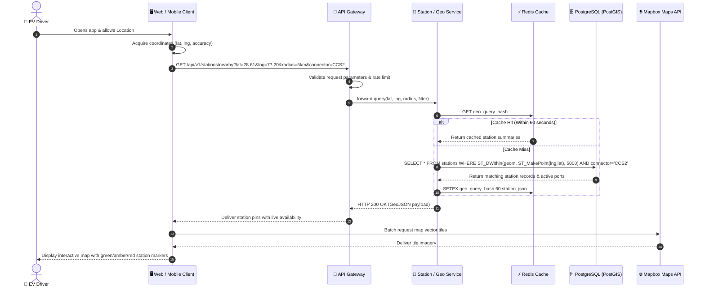
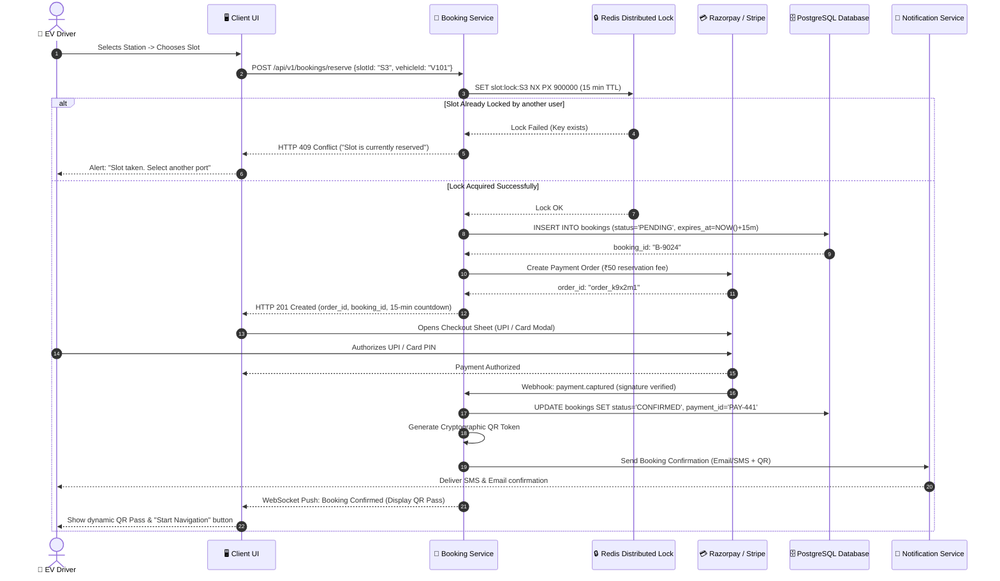
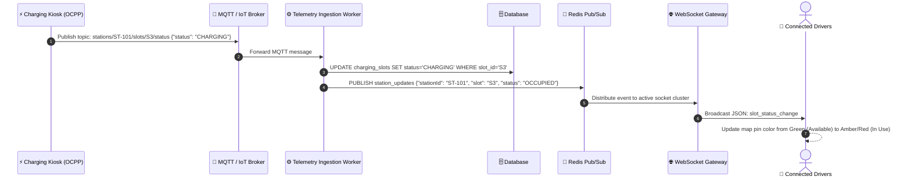
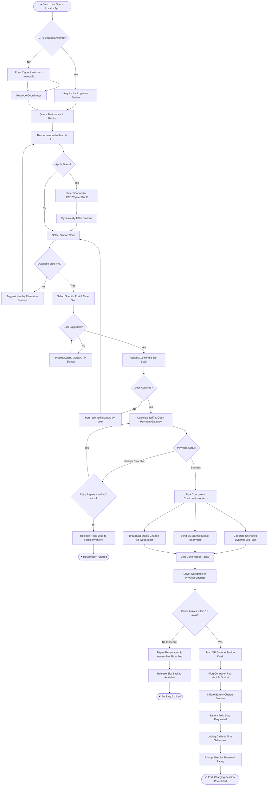
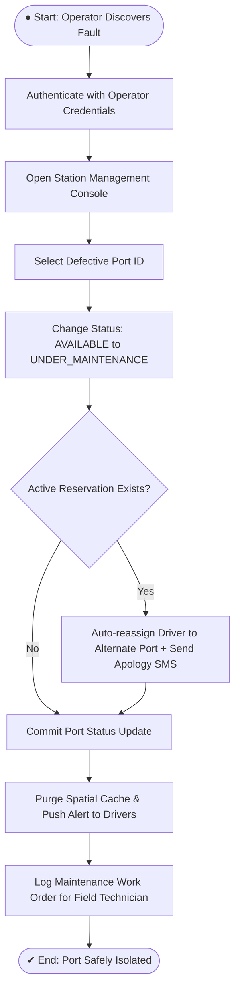

# Experiment 7: UML Sequence and Activity Diagram Modeling

## Dynamic Behavioral & Workflow Interaction Modeling

**Design UML Sequence Diagrams illustrating chronological message exchange patterns, and construct UML Activity Diagrams modeling complex business workflows and concurrency for the EV Charging Station Locator system.**

---

### Aim
To model the dynamic, time-ordered behavioral interactions between system components using UML Sequence Diagrams, and to represent end-to-end operational workflows, decision branching, and concurrency using UML Activity Diagrams for the EV Charging Station Locator.

---

### Objectives
* Identify lifelines, synchronous/asynchronous messages, activation blocks, and return flows in key user scenarios.
* Construct UML Sequence Diagrams for primary business transactions (Geospatial Search, Slot Reservation & Payment, Hardware Telemetry Broadcasting).
* Model business workflows with start/end states, decision diamonds, merge nodes, forks, and joins using UML Activity Diagrams.
* Represent concurrent and distributed asynchronous operations (distributed locking, payment webhooks, real-time push).
* Validate behavioral specifications against the IEEE SRS requirements.

---

### Introduction
While structural diagrams (such as Class Diagrams) illustrate the static architecture of software, dynamic UML diagrams capture how components collaborate over time to fulfill use cases.
* **Sequence Diagrams** emphasize the chronological sequence of messages passed between object lifelines. They are invaluable for designing REST/WebSocket interactions, identifying distributed race conditions, and planning API contracts.
* **Activity Diagrams** depict step-by-step control flows, decision logic, and parallel execution paths within a business process, serving as the bridge between user journey maps and backend transaction boundaries.

---

### Sequence Diagram 1: Geospatial Station Search & Map Rendering

This sequence captures the interaction when an EV driver opens the locator map, queries nearby stations, and filters by connector standard.

---

### Sequence Diagram 2: Slot Reservation & Secure Payment Flow

This sequence models the atomic reservation protocol, ensuring distributed slot locking, third-party payment settlement, and dynamic QR pass generation.

---

### Sequence Diagram 3: Real-Time Hardware Telemetry Broadcasting

Illustrates the real-time IoT integration where physical dispensers update availability via MQTT and WebSockets.

---

### UML Activity Diagram 1: Complete End-to-End User Booking Workflow

The activity diagram models user decisions, edge cases (payment failure, reservation timeout), and parallel actions (sending receipts while launching navigation).

---

### Activity Diagram 2: Station Operator Maintenance Workflow

---

### Observation
Modeling dynamic workflows with sequence and activity diagrams revealed critical operational nuances:
1. Distributed concurrency: using Redis distributed locks with explicit 15-minute TTL guarantees prevents overbooking.
2. Graceful fault handling: separating payment timeout branches ensures locked inventory is systematically returned to public circulation.

---

### Result
UML Sequence Diagrams for Geospatial Search, Slot Reservation & Payment, and Telemetry Broadcasting were created. Comprehensive Activity Diagrams detailing end-to-end user reservation and maintenance workflows were successfully designed and verified.
