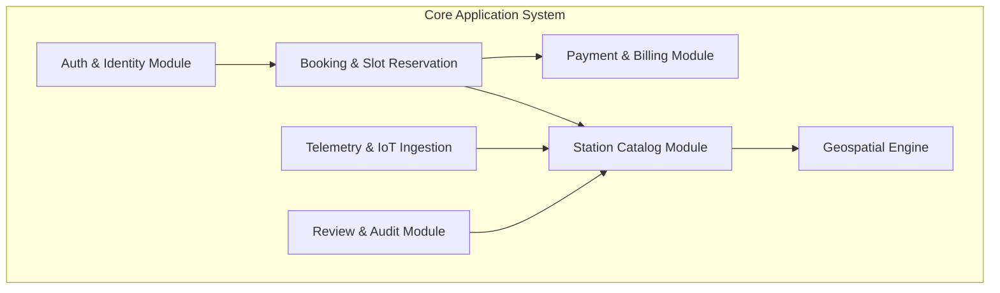
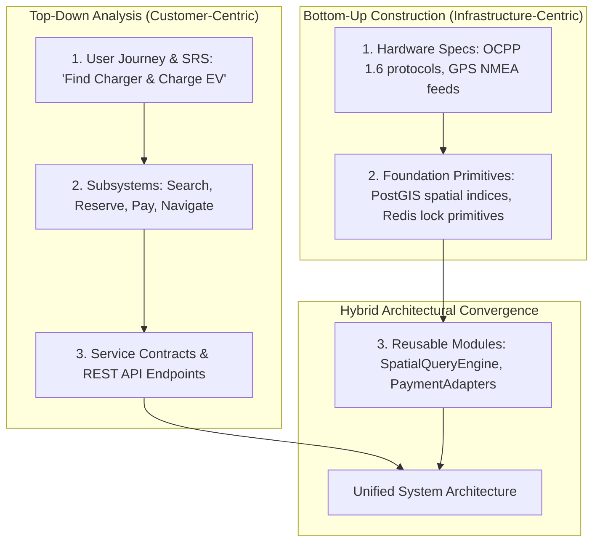

# Experiment 8: Software Design Principles

## Modularization, Coupling & Cohesion Analysis, and Design Paradigms

**Perform a comprehensive software design engineering analysis on the EV Charging Station Locator system covering modularization, coupling and cohesion metrics, function-oriented versus object-oriented design paradigms, and top-down versus bottom-up design strategies.**

---

### Aim
To analyze and apply fundamental software engineering design principles—specifically modularization, coupling minimization, cohesion maximization, design paradigm trade-offs (Function-Oriented vs Object-Oriented), and decomposition strategies (Top-Down vs Bottom-Up)—to the architecture of the EV Charging Station Locator.

---

### Objectives
* Apply modularization principles to decompose the EV platform into maintainable, loosely coupled subsystems.
* Conduct a rigorous qualitative and architectural analysis of coupling and cohesion across all modules.
* Evaluate the architectural trade-offs between Function-Oriented Design (SA/SD) and Object-Oriented Design (OOAD).
* Synthesize Top-Down and Bottom-Up design methodologies into an effective hybrid engineering approach.
* Author the formal Software Design Analysis Report.

---

### Introduction
Software design engineering bridges requirements analysis and implementation. The primary goal of software design is to manage complexity, foster maintainability, facilitate parallel team development, and ensure extensibility. Software design principles—articulated by Parnas, Constantine, Myers, and modern SOLID principles—dictate that high-quality systems exhibit **high cohesion** within modules and **loose coupling** between modules.

---

### 1. Principles of Modularization

Modularization is the process of breaking a complex software application into smaller, discrete, independent units (modules), each responsible for a distinct sub-functionality.

#### Core Modularization Criteria Applied:
1. **Decomposability:** The EV platform is decomposed into 7 bounded contexts (Identity, Station Catalog, Geolocation, Booking, Payment, Telemetry, Feedback), allowing separate teams to work concurrently.
2. **Composability:** Reusable modules (e.g., `GeoMathUtil`, `NotificationService`) can be composed into different workflows without modifications.
3. **Understandability:** A developer inspecting `PaymentProcessor` needs no knowledge of how `MapTileEngine` renders vector tiles.
4. **Continuity:** A change in the external payment gateway API (e.g., upgrading from Stripe v2 to v3) only impacts `PaymentGatewayAdapter`; no UI or database schema changes occur.
5. **Protection:** Hardware port runtime exceptions inside `TelemetryIngestionModule` are caught and isolated, preventing failure from cascading to the booking search engine.

---

### 2. Coupling and Cohesion Analysis

#### A. Coupling Analysis
Coupling measures the degree of interdependence between software modules. The objective in software engineering is to minimize coupling, moving from tight coupling to loose data coupling.

| Coupling Level | Type | Theoretical Definition | Assessment in EV Charging System | Architectural Mitigation Applied |
| :--- | :--- | :--- | :--- | :--- |
| **Highest (Worst)** | **Content Coupling** | One module directly accesses or modifies internal data/memory of another module. | **Eliminated (0%)** | All class properties are private (`-`) or protected (`#`); access is strictly mediated through public getter/setter methods and API boundaries. |
| **High** | **Common Coupling** | Modules share global variables or unrestricted shared database tables. | **Avoided** | Direct database access is restricted via the Repository Pattern; modules communicate via typed interfaces and isolated micro-schemas. |
| **Moderate** | **Control Coupling** | One module controls the internal execution flow of another by passing control flags (e.g., `if (flag == 1) doX() else doY()`). | **Minimized** | Replaced procedural flags with Polymorphic Strategy Patterns (e.g., `PaymentStrategy` instead of passing `payMethodFlag`). |
| **Low** | **Stamp Coupling** | Modules pass composite data structures, but the called module only needs a fraction of the fields. | **Controlled** | Strict Data Transfer Objects (DTOs) like `LocationQueryDTO` pass only relevant coordinates rather than entire user/station objects. |
| **Lowest (Best)** | **Data Coupling** | Modules interact exclusively by passing discrete, primitive data parameters (e.g., `stationId`, `radiusKm`). | **Pervasive (Adopted)** | REST endpoints and service functions rely on atomic scalar parameters and validated DTO payloads. |
| **Ideal** | **Message Coupling** | Modules communicate exclusively through stateless message passing / event pub-sub. | **Adopted for IoT** | Station telemetry events communicate via MQTT and Redis Pub/Sub topics, completely decoupling publishers from subscribers. |

---

#### B. Cohesion Analysis
Cohesion measures how strongly-related and focused the internal responsibilities of a single module or class are. High functional cohesion is the primary goal.

| Cohesion Level | Type | Definition & System Evaluation | Practical Example in Project Codebase |
| :--- | :--- | :--- | :--- |
| **Lowest (Worst)** | **Coincidental** | Tasks in module have no meaningful relationship; arbitrary utility bucket. | *Rejected.* We avoid generic `Helper.js` or `Utils.java` dumping grounds. |
| **Low** | **Logical** | Module performs logically categorized activities grouped by syntax (e.g., handling all inputs). | *Rejected.* Separate dedicated validators are bound to domain contexts. |
| **Moderate** | **Temporal** | Tasks grouped purely because they occur at the same time (e.g., system startup). | Confined strictly to bootstrap scripts (`serverInit.ts`). |
| **Moderate** | **Procedural** | Tasks grouped because they execute in a specific order, though operate on different data. | Used in multi-step wizard controllers. |
| **High** | **Communicational** | Operations operate on the same input data or produce the same output data. | `StationProfileManager`: Handles reading, updating, and exporting a single station record. |
| **High** | **Sequential** | The output of one task serves as the input to the next task in the module. | `BookingPipeline`: `ValidateSlot()` -> `LockInventory()` -> `InitiatePayment()` -> `IssueQRPass()`. |
| **Highest (Best)** | **Functional Cohesion** | Every component in the module contributes to executing a single, well-defined goal. | **`RouteDistanceCalculator`:** Sole responsibility is calculating Haversine distances and spherical spatial paths between two coordinate points. |

---

### 3. Function-Oriented vs Object-Oriented Design

#### Comparative Paradigm Evaluation Matrix

| Comparison Dimension | Function-Oriented Design (SA/SD) | Object-Oriented Design (OOAD) - Selected | Project Justification |
| :--- | :--- | :--- | :--- |
| **Primary Abstraction** | Functions, algorithms, and subroutines. | Classes, objects, and domain abstractions. | Real-world entities (Chargers, Ports, Drivers) naturally map to discrete objects with identity and state. |
| **Data & Logic Binding** | Data structures and functions are separate; data flows through processes. | Data and operations are encapsulated together within class instances. | Prevents state corruption of critical physical hardware (e.g., port status cannot be modified without invoking `lockSlot()`). |
| **Modularity Basis** | Top-down functional decomposition (Data Flow Diagrams / Structure Charts). | Class hierarchies, interfaces, and packages. | High maintainability; allows adding new connector types (e.g., Tesla NACS) via subclassing without altering core logic. |
| **State Management** | Centralized or passed down execution stacks. | Distributed among autonomous objects with private states. | Thread-safe concurrent operations across distributed slot reservations. |
| **Reusability** | Subroutine libraries (procedural reuse). | Inheritance, composition, and polymorphism. | Highly reusable components (`PaymentProcessor` interface implemented by `StripeAdapter`, `RazorpayAdapter`). |
| **Maintainability** | Ripple effect: modifying data format breaks multiple downstream functions. | Changes localized behind encapsulated interfaces (Information Hiding). | Low regression risks when updating billing rules or map tile providers. |

---

### 4. Top-Down vs Bottom-Up Design Strategies

Software engineering in industry requires a pragmatic combination of both top-down decomposition and bottom-up component synthesis.

#### Application to the EV Charging Station Locator:
1. **Top-Down Phase:** Began with stakeholder requirements and user personas (Session 2 & 3). Broken down hierarchically into functional capabilities (SRS in Session 4) and use cases (Session 5).
2. **Bottom-Up Phase:** Evaluated physical charger hardware limitations, OCPP message framing, PostGIS indexing capabilities, and third-party payment gateway webhooks. Developed low-level utility libraries for geospatial math and token encryption.
3. **Architectural Convergence (Sandwich Approach):** The high-level business logic seamlessly connected with robust bottom-up infrastructure primitives at the Service Layer.

---

### Observation
Applying structured modularization and analyzing coupling metrics ensured that components like the payment processor and geospatial search operate with minimal interdependence, guaranteeing that external gateway timeouts do not crash the map visualization.

---

### Result
Principles of modularization were systematically analyzed, coupling and cohesion profiles were rigorously documented, architectural paradigms (Function vs Object-Oriented) were contrasted, and a formal Design Analysis Report was completed for the EV Charging Station Locator.
