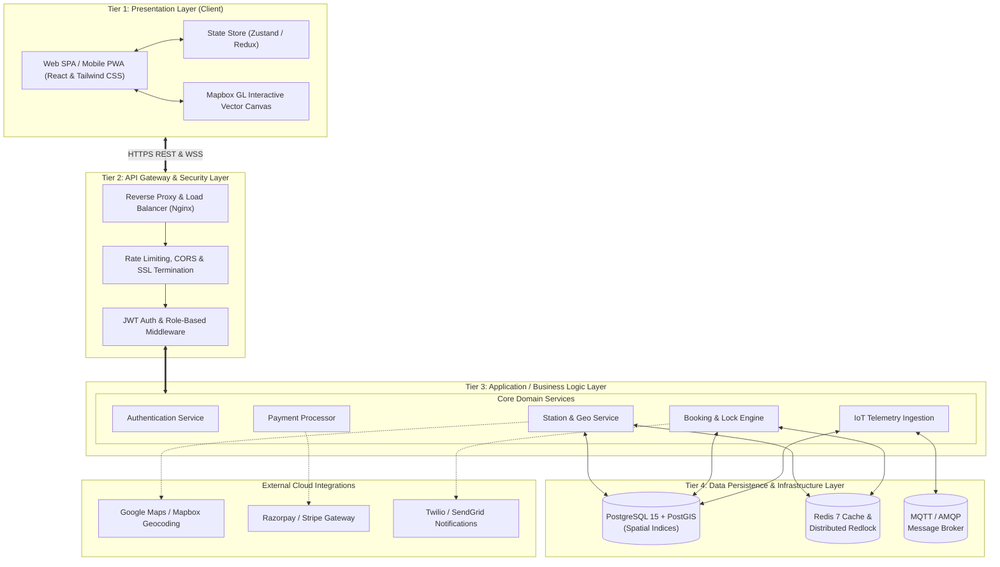
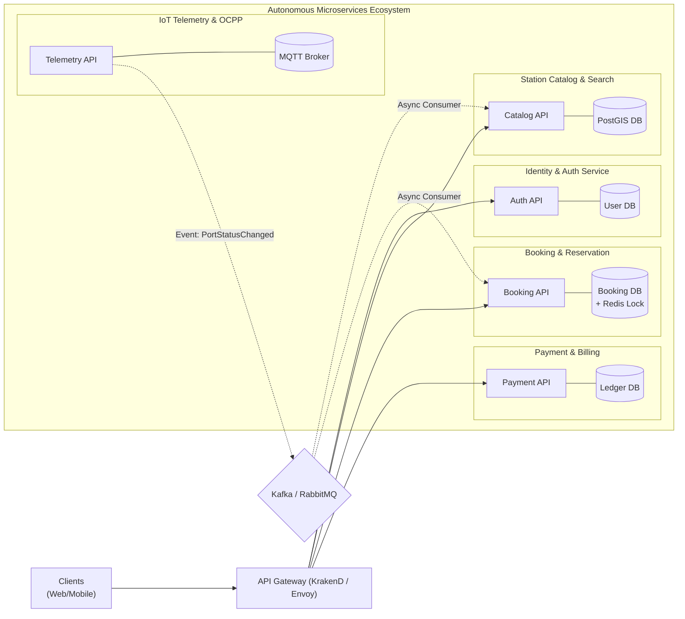
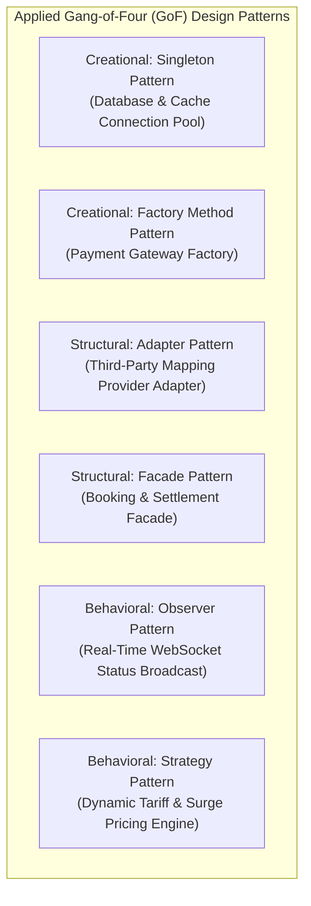

# Experiment 9: Software Architecture Design and Design Patterns

## Architectural Styles, Conceptual Microservices & Software Design Patterns

**Design the multi-tier layered software architecture, analyze the client-server interaction model, evaluate a conceptual microservices decomposition, and apply established Gang-of-Four (GoF) design patterns to the EV Charging Station Locator system.**

---

### Aim
To design a robust, scalable system architecture for the EV Charging Station Locator by synthesizing Layered (N-Tier) architecture, Client-Server communication topologies, conceptual Microservices decomposition, and classic Gang-of-Four (GoF) software design patterns.

---

### Objectives
* Formulate a multi-tier layered software architecture establishing clear separation of concerns across presentation, business logic, persistence, and external service layers.
* Define client-server interaction patterns utilizing stateless REST APIs and real-time bidirectional WebSockets.
* Architect a conceptual microservices decomposition demonstrating service boundaries, independent databases, and inter-service messaging.
* Identify and apply key Creational, Structural, and Behavioral design patterns to solve recurring architectural challenges.
* Author the consolidated System Architecture Planning Report and comprehensive architecture diagrams.

---

### Introduction
Software architecture serves as the master blueprint for a software system, dictating its high-level structure, module allocation, communication protocols, and non-functional quality attributes (scalability, availability, fault tolerance). 

For modern distributed applications such as the EV Charging Station Locator, architecture must balance immediate implementation feasibility with long-term horizontal scalability. A well-designed architecture decouples user-facing interactive maps from mission-critical reservation locks and physical IoT telemetry streams.

---

### 1. Multi-Tier Layered Architecture Design

The core platform is architected according to a **4-Tier Layered Architectural Pattern**:



#### Layer Responsibilities:
1. **Presentation Layer (Frontend):** Renders high-performance map tiles, captures touch/click gestures, executes client-side form validation, and maintains local coordinate states.
2. **Gateway & Security Layer:** Acts as the single entry point (`api.smartcharge.io`), offloading TLS termination, enforcing API token verification, and throttling denial-of-service attempts.
3. **Application Layer (Backend Services):** Encapsulates core business rules: spatial proximity filtering, 15-minute slot holding algorithms, tariff estimation, and invoice generation.
4. **Data Persistence Layer:** PostgreSQL stores ACID-compliant relational entities; PostGIS handles R-Tree spatial indexing for sub-second bounding box queries; Redis provides sub-millisecond memory caching and distributed slot locking.

---

### 2. Client-Server Architecture & Communication Protocols

The system employs a **hybrid Client-Server model** combining synchronous request-response with asynchronous event push:

| Protocol Channel | Underlying Technology | Directionality | Use Case in Project | Rationale |
| :--- | :--- | :--- | :--- | :--- |
| **Stateless REST** | HTTPS / JSON (HTTP/2) | Client -> Server | User login, catalog search, profile updates, checkout | Standardized, cacheable, stateless, easy integration across platforms. |
| **Real-time WebSockets** | WSS (RFC 6455) | Full Duplex (Bidirectional) | Live charger availability pin updates, slot reservation countdown | Avoids wasteful HTTP client polling; pushes status changes within 200 ms. |
| **IoT Telemetry** | MQTT over TCP (OCPP) | Publisher -> Broker -> Subscriber | Physical charging kiosks reporting voltage, current, port status | Lightweight binary/compact JSON payload optimized for cellular IoT SIMs. |

---

### 3. Conceptual Microservices Decomposition

While the initial MVP can be deployed as a modular monolith, the production roadmap is decomposed into autonomous **domain-driven microservices**:



#### Microservices Boundaries & Isolation:
* **Database per Service:** Each microservice manages its own persistent datastore, preventing tight database coupling and enabling independent schema migrations.
* **Event-Driven Asynchrony:** Services communicate critical state transitions (e.g., `PORT_OCCUPIED_EVENT`) via an asynchronous message bus (Kafka/RabbitMQ), preventing cascading failures.

---

### 4. Software Design Patterns Applied (GoF)

To address recurring engineering problems in a clean, maintainable manner, the following design patterns are implemented:



#### A. Singleton Pattern (Creational)
* **Problem:** Repeatedly instantiating database and Redis connection clients causes resource leaks, socket exhaustion, and connection overhead.
* **Solution:** A thread-safe Singleton wrapper ensures only one shared connection pool exists per server instance.
* **Implementation Concept:**
  ```typescript
  class DatabasePool {
    private static instance: DatabasePool;
    private pool: Pool;
    private constructor() { this.pool = new Pool({ max: 20 }); }
    public static getInstance(): DatabasePool {
      if (!DatabasePool.instance) {
        DatabasePool.instance = new DatabasePool();
      }
      return DatabasePool.instance;
    }
    public getClient() { return this.pool.connect(); }
  }
  ```

#### B. Factory Method Pattern (Creational)
* **Problem:** The platform supports multiple payment gateways (Razorpay in India, Stripe internationally, PayPal for cross-border). Hardcoding concrete providers violates Open/Closed Principle.
* **Solution:** `PaymentGatewayFactory` instantiates the appropriate gateway provider implementing a standard `IPaymentGateway` interface based on user region.

#### C. Adapter Pattern (Structural)
* **Problem:** Switching mapping engines (e.g., from Mapbox to Google Maps or OpenStreetMap) requires updating proprietary coordinate transformation calls across the app.
* **Solution:** `MapProviderAdapter` translates generic internal method calls (`renderRoute()`, `fetchIsochrone()`) to vendor-specific APIs.

#### D. Observer Pattern (Behavioral)
* **Problem:** When an EV driver plugs in their car, dozens of other drivers viewing the map need instant notification that the port is now occupied.
* **Solution:** The `StationSubject` notifies all registered client `Observer` sockets via Redis Pub/Sub whenever port status mutates.

#### E. Strategy Pattern (Behavioral)
* **Problem:** Charging tariffs fluctuate based on time-of-day (peak vs off-peak hours), commercial fleet volume discounts, and green solar subsidy hours.
* **Solution:** `PricingStrategy` interface with interchangeable concrete strategies: `PeakHourTariffStrategy`, `OffPeakGreenTariffStrategy`, and `FleetDiscountStrategy`.

---

### Observation
Synthesizing a layered architecture with targeted design patterns ensures that high-volume geospatial reads are isolated from transactional booking locks, and changing third-party payment or map providers requires zero changes to core business logic.

---

### Result
Multi-tier layered architecture, hybrid client-server communication topology, conceptual microservices decomposition, and concrete Gang-of-Four (GoF) design patterns were successfully designed and documented for the EV Charging Station Locator.
